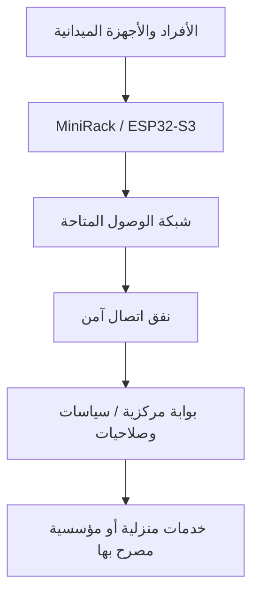
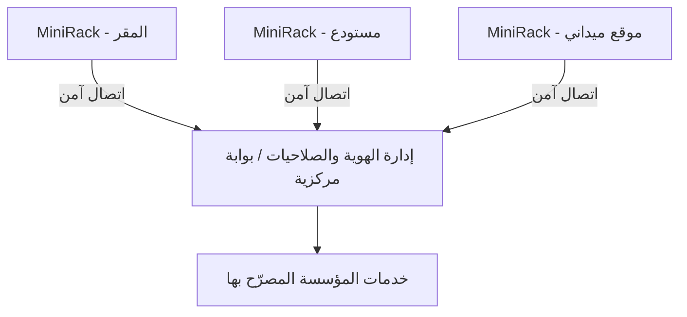

# MiniRack | المعمارية التقنية

## بنية الاتصال

تعتمد المنظومة على **وحدة طرفية محمولة ESP32-S3** توفر نقطة وصول وإدارة للأجهزة، وتتصل ببوابة خدمات عبر شبكة وصول متاحة ونفق مشفّر. تؤدي البوابة وظائف التحقق من الهوية والصلاحيات وسياسات مرور البيانات، ويمكن أن تكون بوابة منزلية أو مؤسسية وفق بيئة النشر.

## بيئة التنفيذ المختبرة

في هذه البيئة، اختُبر نفق WireGuard، ومشاركة الاتصال، وتوقّف المرور عند سحب تصريح **HOME-001**. اختبار وحدة طرفية واحدة لا يثبت تلقائيًا أداء بنية متعددة المواقع.

## توسع المواقع والوحدات

تتيح المعمارية المستهدفة نشر **عدة وحدات ESP32-S3** في مواقع مستقلة، مثل المستودعات والفروع والمواقع الحكومية أو الميدانية، مع إدارة هوية كل وحدة والتصاريح والسياسات عبر بوابة مركزية أو منظومة بوابات.

هذا الرسم **تصميم مستهدف**؛ لم يُثبت بعد تشغيل عدة وحدات MiniRack بالتزامن أو إدارة مؤسسية فعلية متعددة المواقع.

## المسارات والاشتراك الموحد

يُختار مصدر الاتصال الخارجي وفق التغطية والإعدادات المتاحة، مع بقاء الهوية والصلاحيات مرتبطة بالبوابة. وتشمل خارطة التطوير شبكات Wi-Fi والأبراج والاتصال الفضائي الاحتياطي.

يوضح **HOME-001** نموذجًا للتحقق المحلي من حق المرور، وليس اعتمادًا فعليًا لفاتورة منزلية لدى مشغّلين آخرين. يتطلب تشغيل هوية اشتراك واحدة على شبكات متعددة اتفاقيات وتكاملات وتفويضًا من مزودي الاتصال، إضافة إلى العتاد اللازم للربط الخلوي أو الفضائي.

## الأمن التكيفي

يشمل المشروع مكونات لتجريب التصنيف واختيار بعض سياسات الحماية ضمن **AI Adaptive Security Engine**. أما كشف التهديدات وعزل الأجهزة تلقائيًا على مستوى مؤسسي كامل فيحتاج استكمال التنفيذ واختبارات مستقلة، مع بقاء قرار الوصول تحت سياسات واضحة.

## التركيب المادي

تضم الوحدة لوحة ESP32-S3 وشاشة لمس داخل هيكل من سبع قطع STL، مع حيز للبطارية والموصلات ومسارات الأسلاك. يجري استكمال التحقق من التجميع والتغذية الكهربائية. [توثيق المكونات](HARDWARE_INTEGRATION_AR.md).
