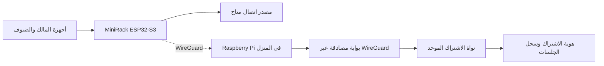

# MiniRack

### راوتر ذكي متنقل وتجربة بحثية لهوية اشتراك إنترنت موحّدة

**MiniRack — Portable Secure Networking & Unified Home-Service Entitlement Research**  
**SAIF Exhibition | Functional Hardware Prototype + Experimental Network Research**

---

## ما هو MiniRack؟

**MiniRack** مشروع لتطوير جهاز اتصال محمول ذكي، بواجهة لمس وإدارة مستقلة للأجهزة، يتكامل مع خادم **Raspberry Pi** داخل المنزل. يجمع بين شبكة Wi‑Fi محلية، والاتصال الآمن، وإدارة صلاحيات **أجهزتي / ضيف / رفض**، ونظام بحثي يتعرف على **هوية اشتراك منزلي واحد** عبر بوابات وصول مختلفة.

**فكرة الابتكار البحثية:** لماذا يبقى استحقاق اشتراك الإنترنت مرتبطًا بموقع المنزل، بينما المستخدم يتحرك؟ نبحث في تصميم آلية موحّدة لمصادقة جهاز متنقل واستحقاق خدمته عبر شبكات وصول أرضية وفضائية متعددة، مع الحفاظ على هوية الاشتراك وتسجيل الجلسات.

> الهدف البحثي هو **قابلية تنقل استحقاق الاشتراك**؛ وليس الادعاء بأن وجود الاشتراك وحده يمنح وصولًا مجانيًا إلى أبراج أو أقمار أو شبكات مشغلين آخرين. توفير النقل الفعلي موضوع هندسي وتشغيلي منفصل.

## المشكلة التي يعالجها المشروع

في الحلول التقليدية، يحتاج المسافر غالبًا إلى إعدادات اتصال متعددة، وربما اشتراك بيانات آخر، رغم أنه يدفع بالفعل مقابل خدمة الإنترنت المنزلية. كما يصعب عليه إدارة أجهزته وضيوفه والوصول إلى بيئته المنزلية بأمان من جهاز متنقل واحد.

يقدّم **MiniRack** نموذجًا لتوحيد إدارة الجهاز والهوية والصلاحيات، ويدرس إمكانية فصل **هوية الاشتراك** عن **شبكة الوصول** المستخدمة أثناء التنقل.

## منظومة MiniRack

**النموذج العتادي الموجود:** لوحة ESP32‑S3 بشاشة لمس 2.8 بوصة ونقطة وصول `MiniRack-Secure`، وخادم Raspberry Pi منزلي.  
**المنظومة البرمجية البحثية:** خدمة مصادقة HTTP موقّعة باستخدام HMAC، وقاعدة SQLite للجلسات والاستحقاقات، وبوابة لا تستمع إلا على واجهة WireGuard المخصصة.

## ما الذي يمكن عرضه عمليًا أمام الحكام؟

| التجربة | الدليل الذي تحقق |
|---|---|
| تشغيل جهاز MiniRack بشاشة اللمس | تشغيل Firmware وواجهة التحكم على الجهاز الحقيقي |
| اتصال الجوال بشبكة MiniRack | تصفح الإنترنت مع إيقاف بيانات الهاتف في اختبارات فعلية سابقة |
| إدارة الأجهزة | شاشة إضافة جهاز جديد بخيارات **أجهزتي / ضيف / رفض مؤقت** |
| الاتصال المنزلي الآمن | اتصال WireGuard بين ESP32‑S3 وRaspberry Pi تحقق سابقًا |
| التعرف على اشتراك المنزل | جهاز ESP32 الفعلي صادق على هويته لدى خدمة Raspberry Pi، وسُجلت جلسة جديدة تلقائيًا بعد إعادة تشغيله |
| التعافي بعد إعادة التشغيل | خدمتا `minirack-core` و`minirack-relay` عادتا بحالة `active` بعد إعادة تشغيل Raspberry Pi |
| استحقاق واحد عبر بوابات متعددة | اختبار برمجي باستخدام بوابات مختبرية مسماة السعودية/اليابان/فضائية لحساب واحد، مع رفض المصادقة عند تعليق الحساب |

**نتيجة موثّقة بتاريخ 2 نوفمبر 2026:** وصل سجل الحساب التجريبي `HOME-001` إلى **3 جلسات مصادقة** عقب اختبارات تشغيل وإعادة تشغيل ESP32 والرازبيري. عدد الجلسات المسجلة لا يعني عدد اتصالات متزامنة. في هذا الاختبار لم تُحسب بعد بايتات الإنترنت الفعلية (`up=0 / down=0`).

للمزيد من الأدلة والتفاصيل: [نتائج الاختبار](docs/RESULTS_2026-11-02_AR.md) · [سيناريو تقديم المعرض](docs/SAIF_EXHIBITION_AR.md)

## أين تكمن القيمة البحثية؟

الابتكار المقترح لا يقوم على اختراع Wi‑Fi أو WireGuard أو HMAC من جديد، بل على دراسة **منظومة انتقال واستيثاق استحقاق اشتراك موحّد** عبر وسائل وصول متعددة. تقارن الدراسة بين التصميم المقترح والطرق المرجعية باستخدام مقاييس مثل زمن المصادقة، والاستعادة بعد الانقطاع، واستمرارية الجلسات، وسلامة احتساب الاستهلاك.

تُعرض مكونات الشبكة الأرضية والفضائية الدولية **كنموذج بحثي ومحاكاة مخطط لها**؛ أما التجارب المباشرة الحالية فتعتمد على ESP32 وRaspberry Pi الموجودين بالفعل. يتم التمييز بين التجربة العتادية والاختبار البرمجي والمحاكاة، للحفاظ على دقة النتائج أمام لجنة التحكيم.

## تجربة العرض الحي | Live Demonstration

1. تشغيل MiniRack أمام الجمهور وإظهار واجهة الجهاز والتعامل مع الأجهزة الجديدة.
2. عرض وصول الجهاز الحقيقي إلى Raspberry Pi ونظام مصادقة الاشتراك.
3. مشاهدة حالة خدمات الرازبيري والجلسات المسجلة وإعادة المصادقة بعد إعادة التشغيل.
4. تقديم نتائج اختبار البوابات المختبرية للحساب الواحد.
5. إضافة محاكاة الشبكة الدولية في **Cisco Packet Tracer** كجزء أخير من العرض عند اكتمال تنفيذها واختبارها.

> لا يقدّم هذا المستودع اتصال 4G/5G دوليًا أو اتصالًا فضائيًا فعليًا، ولا يثبت بعد خروج كامل حركة الإنترنت عبر المنزل أو فرض الاستحقاق على NAT. هذه الحدود التقنية موثقة في [نتائج الاختبارات](docs/RESULTS_2026-11-02_AR.md) وتبقى ضمن برنامج التحقق البحثي.

## محتويات المستودع

| المسار | الوظيفة |
|---|---|
| `src/`, `include/` | Firmware لشاشة ESP32‑S3، والشبكة وإدارة المستخدمين |
| `pi/` | خدمات Raspberry Pi: المصادقة، سجل الاشتراك وبوابة WireGuard |
| `test/` | اختبارات برمجية وسياسات الشبكة |
| `PRINT_3D/` | ملفات الهيكل ثلاثي الأبعاد ونتائج الفحص الهندسي |
| `docs/` | شرح SAIF والنتائج والقيود الفنية والأمنية |

## بناء وتشغيل النسخة البحثية

تُستخدم **VS Code + PlatformIO** للوحة `esp32-s3-devkitc-1`. تبدأ الإعدادات المحلية من الملفات النموذجية `*.example.h`؛ يجب إدخال بيانات الاتصال ومفاتيح كل جهاز **محليًا فقط**. لا يحتوي هذا المستودع على مفاتيح WireGuard الحقيقية أو كلمات مرور الشبكة أو بيانات تعريف الجهاز الخاصة.

راجع ملفات `docs/` قبل إعادة تنفيذ الاختبارات أو تشغيل خدمات الشبكة. بعض الوظائف تتطلب جهاز ESP32 فعليًا وRaspberry Pi مُجهّزًا بصورة مستقلة.

## English abstract

**MiniRack** is a functional ESP32‑S3 touchscreen portable networking prototype connected to a home Raspberry Pi. The project studies the portability of a **single home-service entitlement** across heterogeneous access gateways. Hardware experiments demonstrate device onboarding, Wi‑Fi access and ESP32-to-Pi subscription authentication; software laboratory tests demonstrate signed authorization and accounting identities across three simulated gateway labels. Actual international cellular/satellite transport and carrier billing are outside the demonstrated prototype.

---

**MiniRack | SAIF Research Exhibition**  
*Project source and research prototype. No open-source license is granted by default. Consider intellectual-property review before making the repository public.*
