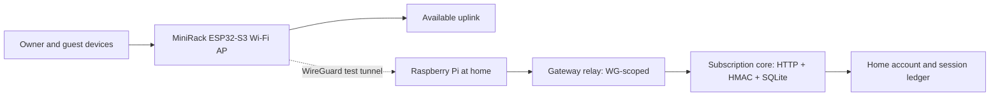

# MiniRack

**MiniRack | Portable Networking & Home-Subscription Research Prototype**  
**مشروع MiniRack — نموذج بحثي للاتصال المتنقل وإدارة الاشتراك المنزلي**

> عرض SAIF البحثي | ESP32-S3 + Raspberry Pi | Live hardware demonstrator + experimental network architecture

## الفكرة / The idea

MiniRack مشروع بحثي لجهاز اتصال متنقل بواجهة لمس، يوزع الإنترنت على أجهزة المالك والضيوف، ويصل إلى Raspberry Pi في المنزل عبر WireGuard. يدرس المشروع أيضًا **آلية ربط هوية جهاز متنقل باستحقاق اشتراك منزلي واحد عبر بوابات وصول متعددة**، مع التحقق من الهوية وتسجيل الجلسات.

The longer-term research question is whether a single home-service entitlement can be recognized across terrestrial and satellite access networks. **A single entitlement does not itself provide free radio access, international transport, carrier authorization or unified commercial billing.** Those require infrastructure and/or agreements.

### شكل النظام / Architecture

> **مهم:** مخطط المصادقة يعمل على عتادنا الحقيقي، لكن المسار المتقطع لا يعني أننا أثبتنا أن كل بيانات عملاء Wi-Fi تخرج للإنترنت عبر المنزل.

## ما تم إثباته / Verified results (2 Nov 2026)

| الجزء | النتيجة | نوع الدليل |
|---|---|---|
| ESP32-S3 touchscreen | الشاشة والواجهة واللمس ورفع Firmware تعمل | اختبار جهاز حقيقي |
| MiniRack-Secure AP | اتصال آيفون وتصفح إنترنت مع إيقاف البيانات الخلوية في اختبارات V1 | اختبار جهاز حقيقي سابق |
| MAIN / GUEST / temporary Reject | شاشة تسجيل جهاز جديد وأزرار أجهزتي/ضيف/رفض؛ رفض جلسة مؤقت لا حظر دائم | اختبار جهاز حقيقي |
| ESP32 ↔ Raspberry Pi | نفق WireGuard تم إثباته سابقًا | اختبار اتصال فعلي |
| اشتراك HOME-001 | ESP32 سجل جلسة مصادقة فعلية لدى خدمة Pi؛ وبعد إعادة تشغيل الطرفين وصل عدد الجلسات المسجلة إلى 3 | اختبار جهاز + خدمة حقيقية |
| بدء خدمات Pi | `minirack-core` و`minirack-relay` رجعتا `active` بعد إعادة التشغيل | systemd على جهاز حقيقي |
| Lab gateways SA / JP / satellite | برنامج تجريبي أنشأ 3 جلسات لحساب واحد ونجح في رفض الحساب الموقوف | HTTP/SQLite/HMAC في مختبر برمجي |
| قياس استهلاك V2 | الجلسات المسجلة للجهاز الحقيقي ظهرت بقيم `up=0/down=0` | التحقق من المصادقة فقط؛ لا إثبات لتتبع بيانات الإنترنت الحقيقي |
| طباعة الهيكل | فحص هندسي لـ 8 ملفات STL | ليست تجربة طباعة أو ملاءمة نهائية |

### ما لم نثبته / Not yet demonstrated

- تشغيل أبراج 4G/5G أو رابط فضائي حقيقي ضمن MiniRack، أو الانتقال الدولي على اشتراك المنزل في شبكة تشغيلية.
- الفوترة الحقيقية، ولا تحويل حركة الإنترنت الدولية على رصيد الفايبر دون اتفاق ناقل.
- أن إنترنت كل عميل يخرج حصريًا عبر الـ Raspberry Pi في المنزل (full-tunnel/fail-closed)، أو عزل أمني مكتمل ومُعتمد لكل الأجهزة.
- معاينة التقطيع والطباعة والتجميع النهائي للهيكل، أو محاكاة Packet Tracer LIVE (مخطط لها كآخر مرحلة).

## ملفات المشروع / Repository contents

| المجلد | المحتوى |
|---|---|
| `src/`, `include/` | Firmware ESP32-S3 وشاشة اللمس وإدارة الأجهزة والاتصال |
| `pi/` | خادم المصادقة ووسيط البوابة واختبارات الرازبيري |
| `test/` | اختبارات السياسات والتكامل البرمجي |
| `PRINT_3D/` | ملفات STL وملاحظات فحصها قبل الطباعة |
| `docs/` | شرح المعرض، القياسات، وضوابط الأمان |

## التشغيل / Build and setup

1. افتح المجلد في **VS Code + PlatformIO**؛ اللوحة `esp32-s3-devkitc-1`.
2. **لا تنسخ أسرار أو إعدادات أي شخص.** انسخ ملفات `.example.h` في `include/` و`src/` إلى الأسماء بدون `.example`، ثم ضع مفاتيحك وكلمات المرور الخاصة محليًا. هذه النسخة لا تحتوي على مفاتيح MiniRack الفعلية.
3. عدّل `platformio.ini` إذا كان لديك مسار مكتبات خاص؛ النسخة العامة أزلت منها مسار Windows الشخصي.
4. نفذ `RUN_MINIRACK_TESTS_WINDOWS.cmd`، أو `bash RUN_MINIRACK_TESTS_LINUX.sh`، ثم اختبر Build/Upload على عتادك.
5. راجع [إعدادات الأمان](docs/SECURITY_AND_PUBLICATION_AR.md) و[طريقة إعداد العرض](docs/SAIF_EXHIBITION_AR.md).

**تنبيه:** لن يعمل اتصال WireGuard من نسخة GitHub كما هي؛ تحتاج مفاتيحك وخادمك الخاص. ولا تُشغّل `pi/*gateway*` أو أي تعديلات جدار ناري دون مراجعة أثرها.

## English summary

MiniRack is a research-oriented ESP32-S3 touchscreen Wi-Fi access point with a home Raspberry Pi, WireGuard connectivity, owner/guest management and a separate experimental HMAC/SQLite entitlement service. Real ESP32-to-Pi authorization and service persistence were observed; SA/JP/satellite labels are *laboratory gateway identities*, not field networks. International roaming, operator billing, satellite data, security certification and end-to-end home-only internet egress are **not claimed**.

**Project status:** Functional experimental prototype; not a commercial cellular/satellite product or certified security gateway.

**Publication note:** No open-source license is granted here. Consult the project owner before reuse. Publishing source before patent review may affect novelty/filing options in some jurisdictions.
