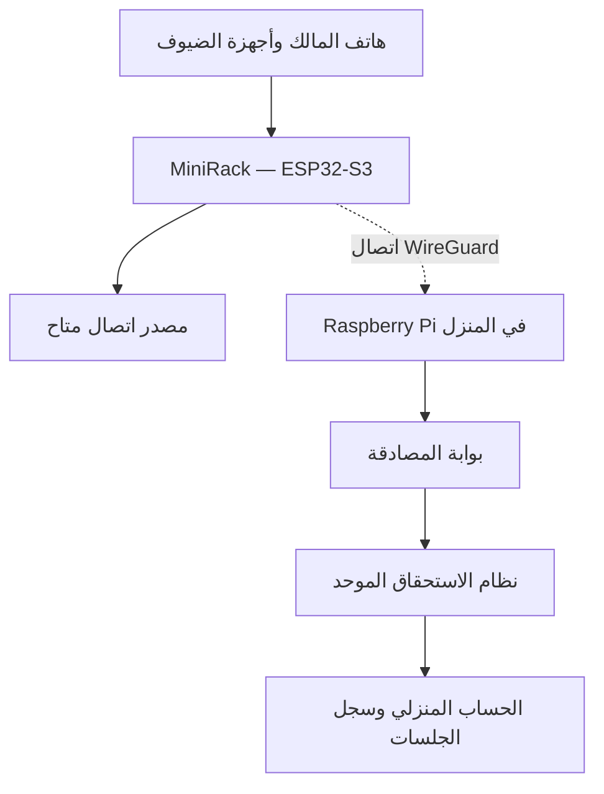

MiniRack
منظومة اتصال متنقلة بهوية اشتراك منزلي موحّدة
MiniRack | Unified Home-Service Connectivity & Portable Network System  
SAIF — مشروع بحثي بنموذج عتادي عامل وتجارب موثقة
---
الفكرة
MiniRack منظومة اتصال متنقلة تجمع جهازًا محمولًا قائمًا على ESP32-S3، وواجهة لمس لإدارة المستخدمين، وخادم Raspberry Pi في المنزل. وتتمحور رؤيتها البحثية حول سؤال محدد:
> **كيف نجعل استحقاق خدمة الإنترنت مرتبطًا بهوية المستخدم وجهازه، لا بموقع الاشتراك المنزلي وحده، بحيث يمكن التحقق منه عبر شبكات وصول متعددة؟**
بدل التعامل مع كل شبكة بوصفها اشتراكًا جديدًا، يدرس MiniRack بنية موحّدة للمصادقة وإدارة الاستحقاق وتسجيل الجلسات. ويطمح المشروع إلى توظيف هذه البنية مستقبلًا في منظومة اتصال أرضية وفضائية مترابطة، مع دراسة متطلبات النقل والتشغيل على نحو مستقل.
المشكلة والقيمة المقترحة
يتغير مصدر الاتصال كلما انتقل المستخدم بين المنزل والسفر ومناطق التغطية المختلفة، بينما تبقى هوية اشتراكه المنزلي منفصلة عن تلك الشبكات. ويضيف ذلك عبئًا في إدارة الحسابات والأجهزة والاتصال الآمن.
يركز MiniRack على ثلاث قيم مترابطة:
هوية خدمة موحّدة: التحقق من ارتباط الجهاز بحساب منزلي واحد عبر بوابات وصول مختلفة.
جهاز اتصال شخصي متنقل: إدارة اتصال المالك والضيوف وصلاحياتهم من واجهة واحدة.
قابلية التوسع البحثي: تطوير آليات المصادقة واستمرارية الخدمة والمحاسبة عند الانتقال بين مسارات الاتصال.
النموذج الذي بنيناه
العتاد: جهاز ESP32-S3 مزود بشاشة لمس قياس 2.8 بوصة، ونقطة وصول لاسلكية باسم `MiniRack-Secure`، وخادم منزلي Raspberry Pi.
البرمجيات: إدارة أجهزة المالك والضيوف، واتصال WireGuard بين الجهاز والخادم المنزلي، وخدمة اشتراك تجريبية تعتمد على HMAC للتحقق من الهوية، وSQLite لحفظ الحسابات والجلسات، وبوابة وصول مخصصة داخل نطاق WireGuard.

أبرز النتائج التجريبية

<strong>تجارب على أجهزة حقيقية</strong>

تشغيل الجهاز: بناء البرمجيات ورفعها إلى ESP32-S3، وتشغيل شاشة اللمس وواجهة التحكم.
الاتصال اللاسلكي: تصفح الإنترنت من هاتف متصل بشبكة MiniRack بعد إيقاف البيانات الخلوية في اختبار موثّق سابق.
إدارة المستخدمين: اختبار شاشة «جهاز جديد» بخيارات أجهزتي / ضيف / رفض. الرفض مؤقت للجلسة، وليس حظرًا دائمًا.
الربط المنزلي: اختبار اتصال WireGuard بين ESP32-S3 وRaspberry Pi.
المصادقة الفعلية: تسجيل جهاز MiniRack الحقيقي على الحساب التجريبي `HOME-001`، وإعادة المصادقة تلقائيًا بعد إعادة تشغيل الأجهزة.
الاستمرارية: عودة خدمتي `minirack-core` و`minirack-relay` إلى حالة `active` بعد إعادة تشغيل Raspberry Pi.

<strong>تجربة مختبرية لنظام الاشتراك الموحد</strong>

أنشأ النظام ثلاث جلسات اختبار مرتبطة بالحساب نفسه عبر ثلاث هويات بوابات: السعودية/أرضية، اليابان/أرضية، اليابان/فضائية. وأظهر اختبار المصادقة قبول الهويات المسجلة ورفض طلب جديد بعد تعليق استحقاق الحساب.
هذه بوابات مختبرية ممثلة برمجيًا لا مواقع اتصالات فعلية. وتثبت التجربة منطق المصادقة وتوحيد الحساب، لا تشغيل شبكة دولية أو فضائية حقيقية.

وثيقة النتائج: الأدلة والقياسات بتاريخ 2 نوفمبر 2026.
العنصر البحثي في MiniRack
الهدف ليس إعادة تسمية تقنيات موجودة مثل Wi-Fi أو VPN، بل اختبار معمارية متكاملة لإثبات استحقاق الخدمة عبر بوابات وصول متعددة، ثم قياس أثرها على زمن المصادقة، واستعادة الجلسات، وضبط الصلاحيات، واحتساب الاستخدام. ويجري التمييز بين:
وظائف نُفذت على العتاد الحقيقي.
وظائف اختُبرت داخل بيئة برمجية محلية.
تصورات التوسع الشبكي المخطط لدراستها ومحاكاتها.
لا تعني هوية الاشتراك الموحّدة، بمفردها، توفير نقل بيانات دولي أو اتصال لاسلكي دون بنية تحتية؛ فتلك متطلبات هندسية وتشغيلية تُدرس ضمن التطوير اللاحق.
تقديم MiniRack في معرض SAIF
يعرض المشروع الجهاز الحقيقي وواجهة إدارة المستخدمين، ثم يوضح ارتباطه بخادم المنزل، ويقدم دليل المصادقة واستعادة الجلسة بعد إعادة التشغيل. وتتضمن المرحلة الأخيرة من خطة العرض محاكاة تفاعلية في Cisco Packet Tracer لفحص مسارات الشبكة وانتقال الاتصال وفق نطاق المحاكاة المتاح.
للاطلاع على تسلسل العرض والأسئلة البحثية: دليل تقديم MiniRack.
بنية المستودع
المسار	المحتوى
`src/` و`include/`	برنامج ESP32-S3، واجهة اللمس، الاتصال وإدارة الأجهزة
`pi/`	خدمات Raspberry Pi للمصادقة وتسجيل الجلسات والبوابة
`test/`	اختبارات البرمجيات والسياسات
`PRINT_3D/`	نماذج الهيكل ثلاثية الأبعاد وملفات مراجعتها
`docs/`	المنهجية، أدلة التجارب، وإرشادات المعرض والأمان
التشغيل وإعادة إنتاج التجربة
يستخدم Firmware بيئة VS Code + PlatformIO للوحة `esp32-s3-devkitc-1`. تتطلب إعادة إنتاج الاختبارات تجهيز ESP32-S3 وخادم Raspberry Pi وإدخال مفاتيح الاتصال الخاصة بكل بيئة من الملفات النموذجية `*.example.h`. لا يتضمن المستودع مفاتيح الجهاز الحقيقي أو كلمات مروره.
يُنصح بقراءة إرشادات الأمان والنشر قبل تشغيل خدمات الشبكة أو استخدام الشيفرة في بيئة أخرى.
---
English abstract
MiniRack is a portable connectivity research system combining an ESP32-S3 touchscreen device with a home Raspberry Pi. Its research focus is a unified home-service entitlement architecture that authenticates a portable device through multiple access gateways while preserving one account identity. The hardware prototype has demonstrated device onboarding, Wi-Fi connectivity, WireGuard communication, and real ESP32-to-Pi authorization with recovery after reboot. Separate software-laboratory experiments have validated multi-gateway entitlement logic. International cellular or satellite service is a research direction, not a field-tested capability of this prototype.
MiniRack | SAIF Research Project — Experimental prototype and documented research.
