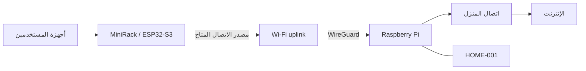

# المعمارية التقنية | MiniRack

## مكونات البنية

تعتمد البنية على وحدة طرفية محمولة **ESP32-S3**، وبوابة منزلية **Raspberry Pi**، وطبقة اتصال آمن بينهما. يوفر ESP32-S3 نقطة Wi-Fi وواجهة إدارة الأجهزة، بينما تتولى بوابة المنزل خدمة النفق وسياسة صلاحية HOME-001.

## التركيب المادي

يجمع تصميم الوحدة المحمولة لوحة ESP32-S3 والشاشة داخل هيكل مطبوع ثلاثي الأبعاد. ويتضمن تخطيط التكامل الداخلي مساحة لبطارية ليثيوم بوليمر وموصلًا متعدد الأطراف ومسارات للأسلاك. توثيق المكونات الكهربائية والميكانيكية في [ملف تكامل العتاد](HARDWARE_INTEGRATION_AR.md).

## إدارة الصلاحيات

تتيح الواجهة تصنيف اتصال الأجهزة إلى فئات يديرها المالك، مع التحقق من أهلية مرور البيانات عبر بوابة المنزل. ويستطيع المالك إدارة الأجهزة من شاشة MiniRack مباشرة.

## رؤية الاتصال الموحد

تتوسع المعمارية المقترحة بإضافة طبقة تحقق مشتركة تستطيع التعرف على هوية اشتراك HOME-001 عبر شبكات وصول متعددة، مع اختيار المسار بحسب توافر الاتصال وسياسة الأولوية.

هذا الجزء يُمثل تصميمًا لتكامل الشبكات ويتطلب مشاركة بنية المشغّلين ووسائل الوصول المناسبة. ولا يُعد وجود إعدادات 4G/5G أو الأقمار في الواجهة اتصالًا لاسلكيًا فعليًا بتلك الشبكات.
